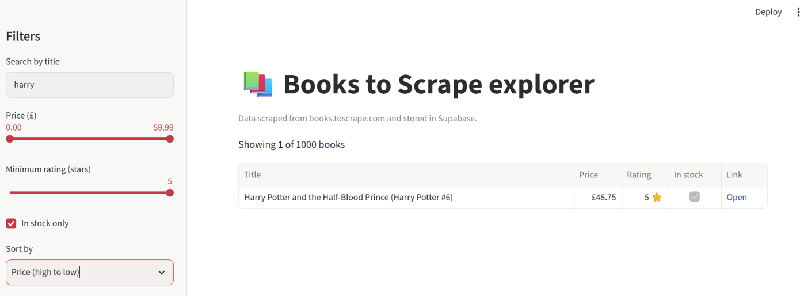
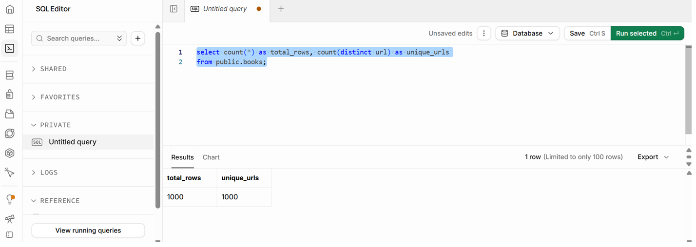
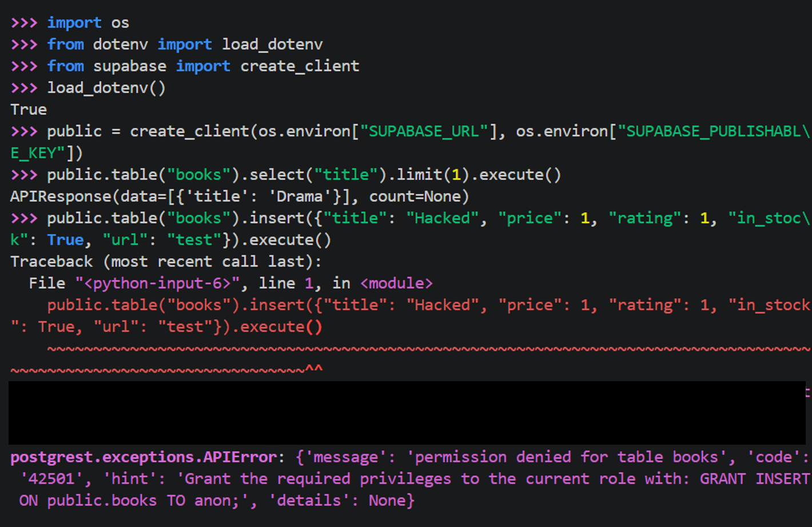
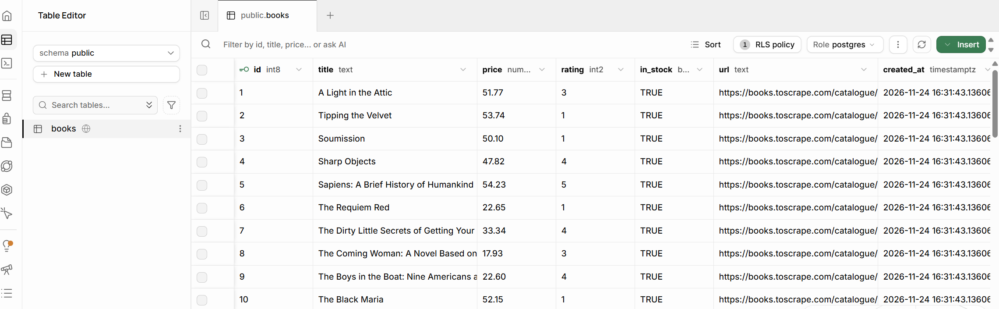

# Books to Scrape

Collects data on all 1,000 books from [books.toscrape.com](https://books.toscrape.com), stores it in a Supabase (PostgreSQL) database, and lets users search, filter and sort it through a Streamlit web interface.



## Purpose

I built a small data pipeline around Books to Scrape, a demo online bookshop made for practising web scraping. A Python script visits all 50 pages of the shop, collects the title, price, rating, availability and link of every book (1,000 in total), cleans the data and saves it in a Supabase database. A Streamlit web page then reads the books from the database and lets anyone search, filter and sort them, for example to find the cheapest 5-star books that are in stock.

Features:
- Scrapes all 50 catalogue pages (1,000 books) politely, with a pause between requests
- Cleans the data into proper types (price as a number, rating as 1–5, stock as true/false)
- Stores the books in Supabase without duplicates, even when the scraper is run again
- Web interface to search by title, filter by price, rating and availability, and sort the results

### How it works

```
books.toscrape.com  →  scraper.py  →  Supabase (books table)  →  app.py (Streamlit)
   the source          collect,          stored permanently         search, filter,
                       clean, save                                  sort for users
```

## Data collection

- **Source:** [books.toscrape.com](https://books.toscrape.com), a demo bookshop built for practising web scraping.
- **How:** `scraper.py` downloads each catalogue page with `requests` and reads the HTML with `BeautifulSoup`. It starts at the home page and follows the **next** link until the last page (page 50 has no next link).
- **Politeness and reliability:** a 0.5 second pause between pages, a 10 second timeout per request, and `raise_for_status()` so a failed download stops with a clear error.
- **Fields and cleaning:**

| Field | On the website | Stored as |
|---|---|---|
| `title` | `title` attribute of the link (the visible text is cut short) | text |
| `price` | `£51.77` | number (`51.77`) |
| `rating` | CSS class `star-rating Three` | number 1–5 (`3`) |
| `in_stock` | `In stock` | true / false |
| `url` | relative link (`catalogue/...`) | full URL, made absolute with `urljoin` |

- **Result:** 1,000 books, each with a unique URL (checked by the script before saving).

## Data persistence

- **What:** one table, `books`, with the five fields above plus an automatic `id` and `created_at`. The table definition, including its security rules, is in [`schema.sql`](schema.sql).
- **Where:** a hosted PostgreSQL database on [Supabase](https://supabase.com).
- **Why Supabase / a database:** Supabase was the database required for this course. Using it also made sense for the project: the scraped data has to outlive the script (a Python list disappears when the program ends), so the interface can show it without re-scraping the website every time. A database table also enforces fixed column types and rules (for example, a rating must be between 1 and 5, and each URL can appear only once), and it lets the scraper and the interface share the same data while having different permissions: the scraper can write, and the interface can only read.
- **No duplicates:** `url` is `unique` in the table, and the scraper uses an **upsert** (`on_conflict="url"`): existing books are updated, new ones inserted. Running the scraper twice still leaves exactly 1,000 rows.



### Security: who can do what

| Who | Key used | Permissions |
|---|---|---|
| Scraper (`scraper.py`) | Secret key (`sb_secret_...`) | Read, insert, update |
| Interface (`app.py`) and the public | Publishable key (`sb_publishable_...`) | **Read only** (Row Level Security policy + grant) |

Nobody can delete rows through the API. Each part gets only the access it needs (least privilege). Tested: with the publishable key, reading works, but inserting a row is refused with `permission denied for table books`.



The keys are stored only in a local `.env` file, which is excluded by `.gitignore` and never committed. [`.env.example`](.env.example) shows the required variable names with placeholder values.

## User interaction

1. **(Optional) Refresh the data:** run `python scraper.py`. It takes about a minute and prints its progress page by page.
2. **Open the interface:** run `streamlit run app.py`. The app opens in the browser at `http://localhost:8501`.
3. Use the **sidebar** to:
   - search by title
   - set a price range
   - set a minimum star rating
   - show only books in stock
   - choose the sort order
4. The table updates immediately and shows how many books match. Click **Open** to go to a book's page on the original site.



## Setup

**Requirements:** Python 3 (developed and tested with 3.14), a free [Supabase](https://supabase.com) account, and an internet connection.

1. **Clone the repository** and go into this folder:
   ```bash
   git clone https://github.com/depauwanna-afk/final-assignment.git
   cd final-assignment/books-to-scrape
   ```
2. **Create and activate a virtual environment:**
   ```powershell
   python -m venv venv
   .\venv\Scripts\Activate.ps1        # Windows (PowerShell)
   # source venv/bin/activate         # macOS / Linux
   ```
3. **Install the dependencies:**
   ```bash
   pip install -r requirements.txt
   ```
4. **Create the database:** create a new Supabase project (keep **Data API** enabled), open the **SQL Editor**, paste the contents of [`schema.sql`](schema.sql) and run it.
5. **Configure your keys:** copy `.env.example` to a new file called `.env`, and fill in your own values from **Project Settings → Data API / API Keys**. `SUPABASE_URL` must be only the base address, ending in `.supabase.co`, with nothing after it.
6. **Collect the data:** `python scraper.py`
7. **Start the interface:** `streamlit run app.py`

**Troubleshooting:**
- `Missing SUPABASE_URL ...`: the `.env` file is missing or a variable name is misspelled.
- `PGRST125 Invalid path specified in request URL`: `SUPABASE_URL` has extra text after `.supabase.co` (e.g. `/rest/v1/`).
- `permission denied for table books` when **running the scraper**: `schema.sql` was not run completely (the grants are missing).
- On Windows, *"running scripts is disabled"* when activating: run `Set-ExecutionPolicy -Scope CurrentUser RemoteSigned` once.

### Files

| File | Role |
|---|---|
| `scraper.py` | Scrapes all pages, cleans the data and upserts it into Supabase (secret key) |
| `app.py` | Streamlit interface: reads from Supabase (publishable key), with search, filters and sorting |
| `schema.sql` | Creates the `books` table, the permissions and the Row Level Security policy |
| `requirements.txt` | Python dependencies |
| `.env.example` | Template for the required configuration (placeholder values only) |

## Learning

### What I learned

- **How a scraper reads a website.** Before writing code, I used Chrome's Inspect tool to find where each piece of data sits in the HTML. For example, the full title is in the link's `title` attribute because the visible text is cut short, and the rating is a CSS class (`star-rating Three`), not a number.
- **Cleaning data.** Scraped values arrive as text, so I converted them: `float()` for prices, a dictionary to turn `"Three"` into `3`, and a comparison to turn `"In stock"` into `True`. Clean, typed data is what allows the database to reject bad values and the interface to filter and sort.
- **Following pagination politely.** The scraper keeps following the **next** link until there is none, with `time.sleep()` between requests so the site isn't flooded.
- **Databases and avoiding duplicates.** Making `url` unique and using an upsert means re-running the scraper updates the existing books. I checked this by running it twice and counting the rows (still 1,000).
- **Keeping secrets out of the code.** The Supabase keys live only in `.env`, which I proved was ignored with `git check-ignore` before pasting any keys in. The code only refers to the variable names.
- **Least privilege.** The scraper uses the secret key because it needs to write. The interface uses the publishable key, which `schema.sql` limits to reading. I tested that an insert with the publishable key is refused. The error message even suggested running `GRANT INSERT ... TO anon`, which I deliberately did not do, because it would have let anyone write to my database.

### A challenge I encountered and how I approached it

When I first sent the books to Supabase, the scrape worked but the upload failed with `PGRST125: Invalid path specified in request URL`. The error code and message told me the request had reached Supabase but at the wrong address, so the problem was in my configuration, not my code. My `SUPABASE_URL` in `.env` contained extra text after `.supabase.co`, and since the Python library adds `/rest/v1` itself, the final address didn't exist. After shortening it to the base URL, the upload worked. I also managed to debug this without ever sharing my key values, only describing how the URL ended.

A second, smaller challenge was the encoding: without `response.encoding = "utf-8"`, the £ sign was read as `£`, and converting the price to a number crashed with `could not convert string to float: 'Â51.77'`.

## Limitations and assistance

### Limitations

- **Only the fields on the catalogue pages** are collected. Categories, descriptions and exact stock counts are on each book's own page, which would need 1,000 extra requests.
- **The data is a snapshot.** It only changes when the scraper is run again. Books removed from the website are not removed from the database (by design, nothing is deleted through the API).
- **No partial saves or retries.** The scraper collects all 50 pages before uploading, so if it fails halfway nothing is saved and it must be run again.
- **Depends on the website's HTML.** If the site's structure changed, the scraper would need updating.
- **The interface runs locally** (`localhost`) and is not deployed online. It loads all books and filters them in Python, which is fine for 1,000 rows but would not scale to very large datasets.
- `created_at` records when a book was first added, but there is no "last updated" column.
- Tested only on Windows with Python 3.14.

### Assistance

- **AI tools:** I used Claude (Anthropic) as a tutor throughout this project. It explained each concept step by step (scraping, data cleaning, pagination, Supabase, Row Level Security, `.env` files, Streamlit), provided example code for each step, which I added to my files and tested myself, and helped me understand error messages when I got stuck. It also helped me draft parts of this README from a learning log of my own questions and problems, which I reviewed and edited.
- **Data source:** [books.toscrape.com](https://books.toscrape.com), a sandbox site provided for scraping practice.
- **Services and libraries:** [Supabase](https://supabase.com) (database), `requests`, `beautifulsoup4`, `supabase`, `python-dotenv`, `streamlit` and `pandas`.
- No other tutorials or external code were used.
