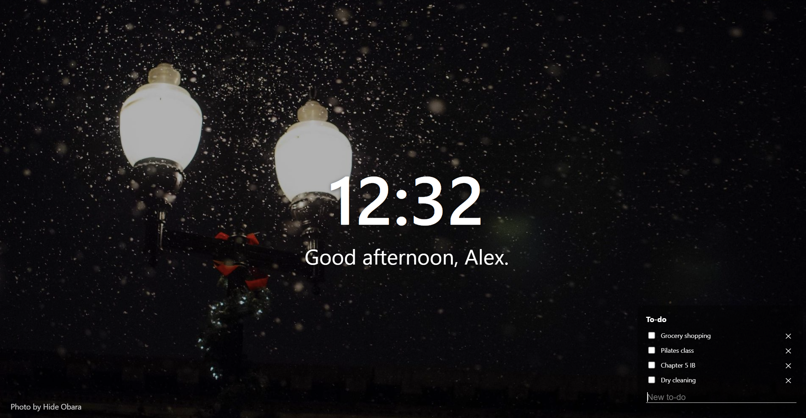
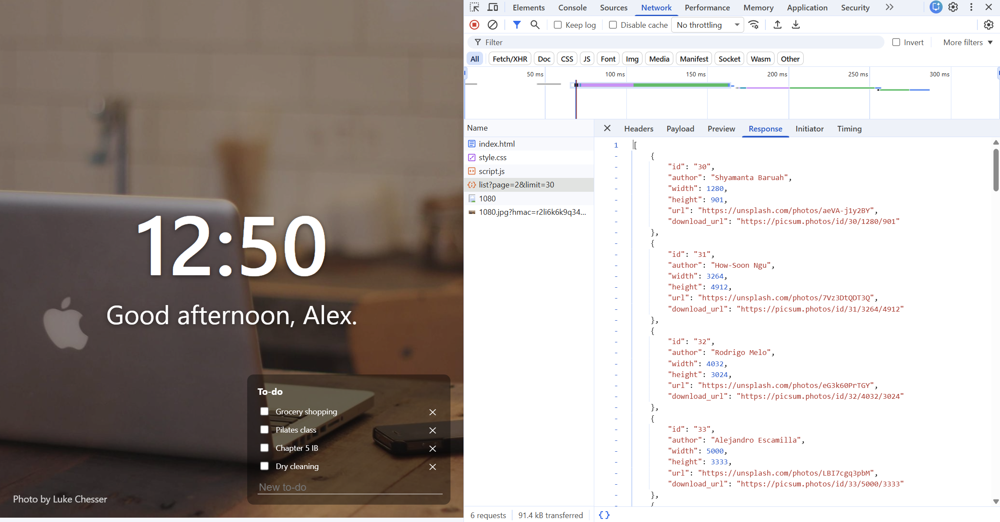
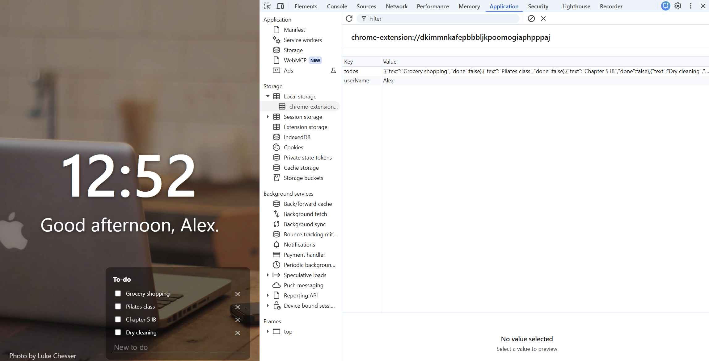

# Momentum Dash replica

A Chrome extension that replaces the new tab page with a personal dashboard, inspired by [Momentum](https://momentumdash.com/).



## Purpose
I built a chrome extension that improves the layout by showing a new picture everytime I open a new tab and it showcases the time and my to-do list. 

Features:
- Live clock with a greeting that changes with the time of day (morning / afternoon / evening)
- Asks for the user's name once and remembers it
- To-do list: add, tick off and delete tasks, saved between sessions
- A random background photo on each new tab, with the photographer's name

## Data collection

- **Background photos:** from the [Lorem Picsum API](https://picsum.photos/) (free, no API key needed). On each new tab, the extension calls `https://picsum.photos/v2/list?page={1-10}&limit=30` with `fetch`, picks one random photo from the returned JSON list, and loads it at screen size from `https://picsum.photos/id/{id}/1920/1080`. The `author` field is shown as the photo credit.
- **Time:** from the computer's clock, using JavaScript's `Date`.
- **User input:** the name and to-do items the user types.

If the API cannot be reached (for example, offline), the error is caught and the page keeps a plain dark background, so the rest of the dashboard still works.



## Data persistence

Data is saved with the browser's `localStorage`, under two keys:

| Key | What it stores | Format |
|---|---|---|
| `userName` | The user's name | Text |
| `todos` | The to-do list | JSON array, e.g. `[{"text":"Gym","done":false}]` |

**Where:** in Chrome's local storage for this extension, on this computer and Chrome profile only. The name and to-do items are never sent anywhere. The only network requests are to Lorem Picsum to load the background photo; like any website, Picsum receives standard request information (such as your IP address), but none of your saved data.

**Why `localStorage`:** 
Chrome extension store lightweight data which is handled well by local storages. No server or database is needed as the extension is directly on the computer and does not require any identifications/external accesses.

Photos are not stored; a new one is fetched each time.



## User interaction

1. Open a new tab (Ctrl + T). The dashboard appears instead of Chrome's default page.
2. On the first visit, type your name and press **Enter**.
3. To change your name later, **double-click the greeting**.
4. In the to-do panel (bottom right), type a task and press **Enter** to add it. Tick the checkbox to mark it done, or click **✕** to delete it.

## Setup

**Requirements:** Google Chrome (or another Chromium browser, such as Edge), and an internet connection for the background photos. There are no dependencies to install, no build step, no configuration and no API keys.

1. Clone the repository:
   ```bash
   git clone https://github.com/depauwanna-afk/final-assignment.git
   ```
2. In Chrome, go to `chrome://extensions`.
3. Turn on **Developer mode** (top right).
4. Click **Load unpacked** and select the `momentum-dash` folder.
5. Open a new tab. If Chrome asks whether to keep the change, choose **Keep it**.

After changing the code, open a new tab to see changes. After changing `manifest.json`, click the reload button on the extension's card in `chrome://extensions`.

### Files

| File | Role |
|---|---|
| `manifest.json` | Tells Chrome what the extension is and that it replaces the new tab page (Manifest V3) |
| `index.html` | Page structure: clock, greeting, name form, to-do panel, photo credit |
| `style.css` | Layout and styling |
| `script.js` | All behaviour: clock, greeting, name storage, to-do list, background API |

## Learning

### What I learned

- **How a Chrome extension is built.** An extension is just a folder of normal web files (HTML, CSS, JavaScript) plus a `manifest.json` that tells Chrome what to do. One line, `chrome_url_overrides` → `newtab`, is what replaces the new tab page. I also learned that extensions block JavaScript written inside the HTML, so all code has to be in a separate `.js` file.
- **How JavaScript changes the page.** The HTML only provides empty "slots" with ids (like `id="time"`). JavaScript finds them with `getElementById` and fills them by setting `textContent`. The clock uses `setInterval` to run every second, and I call the function once first so the page doesn't show `00:00` for a second.
- **How to save data in the browser.** `localStorage` keeps data even after Chrome is closed, but it can only store text. To save my to-do list (an array of objects), I convert it with `JSON.stringify` and turn it back with `JSON.parse`. I could see both saved keys, `userName` and `todos`, in DevTools → Application → Local storage.
- **How to get data from an API.** I used `fetch` with `async`/`await` to get a list of photos from the Lorem Picsum API as JSON. I wrapped it in `try`/`catch` and tested it with DevTools set to "Offline": the photo fails, but the rest of the page keeps working.
- **A basic security rule.** Text typed by a user (or coming from an API) should be inserted with `textContent`, not `innerHTML`. I tested this by adding the to-do `<b>hello</b>`: it appeared as plain text and not in bold, which shows the browser isn't running user input as code. With `innerHTML`, the browser would parse the text as HTML, so untrusted input could inject code that runs on the page (an XSS attack).
- **Using my tools.** The DevTools Console is the first place to look when something doesn't work. I also learned that Git and Chrome only read files *saved* to disk: twice something "didn't work" simply because a file wasn't saved (a white dot on the VS Code tab).

### A challenge I encountered and how I approached it

After adding the "What's your name?" feature, the form didn't appear, even though the clock still worked. Chrome's extension error page pointed to line 36 of `script.js` (`nameForm.hidden = false;`).

My first guess was that the problem was in the HTML (a missing form or a wrong id), so I checked `index.html`, but it was correct. Then I read the full error message at the top of the error page: `Uncaught ReferenceError: nameForm is not defined`. "Not defined" meant the variable had never been created. I had skipped adding the `const nameForm = document.getElementById("name-form");` line at the top of the file. After adding it, clearing the old errors and reloading, everything worked.

What I took from this:
- One error stops all the JavaScript after it. That's why the clock (earlier in the file) worked but the form (later) didn't.
- "X is not defined" means a missing variable in the JavaScript, while "Cannot set properties of null" means the variable exists but the element wasn't found in the HTML.
- Read the full error message before guessing, and clear old errors in Chrome, because it keeps showing them even after they're fixed.


## Limitations and assistance

### Limitations

- **Fewer features than the real Momentum.** There is no weather, daily quote or "main focus" for the day.
- **The photo changes on every new tab, not once a day.** Each new tab makes a new request to the API, so the extension needs an internet connection for the background. Without one, it falls back to a plain dark background. Photos are only picked from the first 300 in the Lorem Picsum list (10 pages × 30 photos).
- **Data is only stored locally.** The name and to-do list live in this Chrome profile's `localStorage`. They are not synced between computers, and they are deleted if the extension is removed or the browser data is cleared.
- **Changing your name is not obvious.** It works by double-clicking the greeting, but nothing on the page tells the user this.
- **The layout is not fully responsive.** In a narrow window (for example, with DevTools open), the to-do panel can overlap the greeting.
- **Not published.** The extension has no custom icon and is not on the Chrome Web Store; it is loaded as an unpacked extension in Developer mode.
- **Testing.** Only tested in Google Chrome on Windows.

### Assistance

- **AI tools:** I used Claude (Anthropic) as a tutor throughout this project. It explained each concept step by step (Chrome extensions, the DOM, `localStorage`, `fetch`/`async`, `textContent` vs `innerHTML`), provided example code for each step, which I added to my files and tested myself, and helped me understand error messages when I got stuck. It also helped me draft parts of this README (Learning, Limitations and Assistance) from a learning log of my own questions and problems, which I reviewed and edited.
- **External services:** background photos come from the [Lorem Picsum API](https://picsum.photos/), which sources its images from [Unsplash](https://unsplash.com/).
- **Inspiration:** the design and features are based on [Momentum](https://momentumdash.com/). This project is not affiliated with Momentum, and no code was copied from it.
- No other tutorials or external code were used.